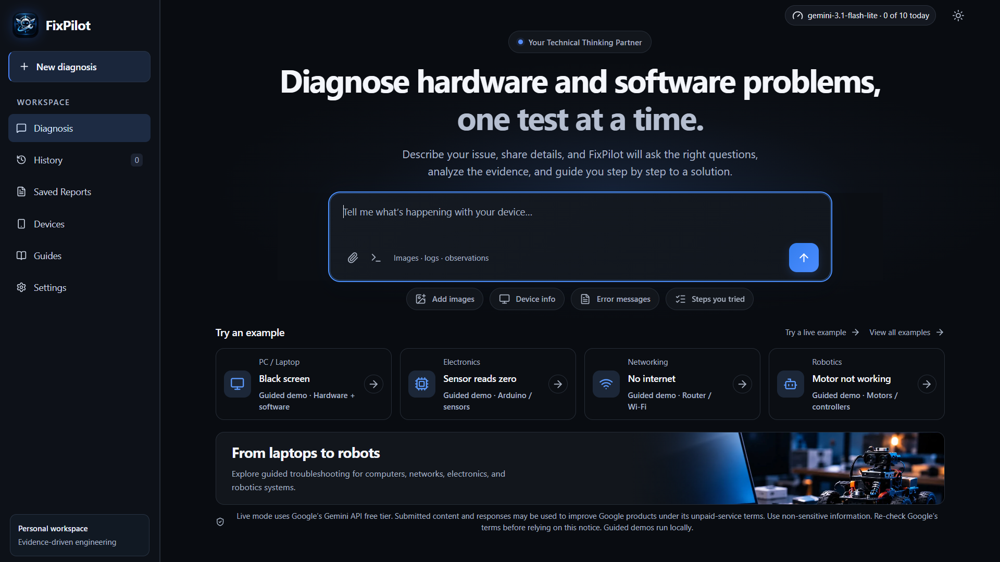
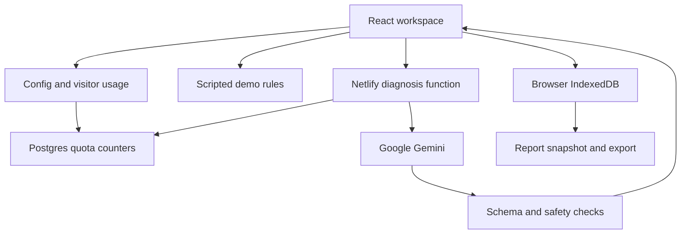

# FixPilot


[](https://doi.org/10.5281/zenodo.23493279)

FixPilot is an evidence-driven troubleshooting assistant for hardware and software, including laptops, networking, hobby robotics and embedded devices. It gathers observations, ranks possible causes, proposes a safe next test and saves a provisional diagnostic report. Four scripted guided demos use simulated evidence and run locally. Optional live diagnosis connects to Google Gemini through a server-side API, with bounded usage and structured-output validation.

**[Open the live demo](https://fixpilot-labs.netlify.app/)** · [Testing](docs/VERIFICATION.md) · [Setup and deployment](docs/PUBLISH.md)

Guided demos work without a provider key. Live mode is disabled by default in a fresh installation; its availability on the hosted site is shown by the mode indicator.

## Project Preview



## Watch FixPilot in Action

A 59-second recording of a live diagnostic session.

Starting from a laptop that powers on but shows a black screen, FixPilot uses Google Gemini to investigate the issue, rank possible causes, and recommend targeted diagnostic tests. When the user cannot perform a suggested test, FixPilot adapts by proposing an alternative instead of repeating the same instructions. The session concludes with a saved report documenting the diagnostic progress and current assessment.

https://github.com/user-attachments/assets/19312f07-c1b5-4f5c-93a7-519002647cdf

> **Note:** This is a recorded session, not an accuracy benchmark. Cause weights are model-estimated relative values, not measured probabilities. Diagnostic suggestions are provisional and require verification; FixPilot is not a substitute for a qualified technician.

## Features

- Four branching guided demos: robot motor failure, laptop black screen, Arduino sensor readings and Wi-Fi connectivity.
- Opt-in live diagnosis with text and one PNG, JPEG or WebP image per message, up to 2 MiB.
- Evidence notebook, ranked causes, targeted diagnostic tests, safety checks and provisional repair/verification steps.
- Browser-local history, session titles, rename/delete, resolution status and report snapshots with HTML export and browser printing.
- Light/dark themes, mobile evidence drawer, loading and friendly error/limit states.
- A keyboard-accessible mode/usage popover backed by the actual visitor quota counter. Unknown usage is labelled unavailable, never presented as zero.

## Diagnostic loop

1. A guided case starts from authored hypotheses; a live case starts from an empty structured diagnostic state.
2. Live mode sends the latest state, up to 16 recent text messages, the new message and its optional image to a Netlify Function. A fixed system prompt treats user material as untrusted evidence.
3. Gemini proposes updated hypotheses and a safe test or targeted questions. Question selection is model-generated; there is no mathematical information-gain optimizer.
4. The server validates output with Zod, checks for dangerous actions and normalizes nonzero cause weights to total 100. Live display values round to the nearest 5%, so displayed totals may differ slightly from 100.
5. The browser stores the validated reply. A report is a local snapshot of that diagnosis, not a separate model-generated report.

Guided cases use explicit branching rules and authored weights. Free text does not manufacture simulated test outcomes. See the [structured-output schema](docs/diagnostic-state.schema.json).

**Live cause weights and confidence are model-estimated relative assessments, not measured or calibrated probabilities.** They assume one main root cause; multiple simultaneous faults can exist. Demo weights are authored, not model estimates.

## Architecture



React, TypeScript, Vite, Tailwind CSS, Radix UI, Lucide, Zod, IndexedDB, Netlify Functions and Netlify Database form the stack. The default server model is `gemini-3.1-flash-lite`, configurable through `GEMINI_MODEL`. A lightweight multimodal model is used for the limited demo; no comparative cost, latency or accuracy advantage has been measured.

| Path | Purpose |
| --- | --- |
| `src/App.tsx`, `src/components/` | Workspace, conversation, reports and mode indicator |
| `src/lib/diagnose.ts`, `src/lib/live-config.ts` | Client request coordination and disabled-live guard |
| `src/lib/workspace.ts` | Browser IndexedDB history, images and report snapshots |
| `src/lib/diagnostic/` | Shared schema, safety policy, session logic and demos |
| `netlify/functions/` | Config/usage and live diagnosis endpoints |
| `netlify/lib/` | Provider transport, validation, signed visitor identity and quotas |
| `netlify/database/migrations/` | Quota-counter schema |
| `tests/`, `.github/workflows/check.yml` | Automated checks and CI |
| `scripts/scan-public.mjs` | Source and built-frontend scan |

## Live mode and usage

Live mode is enabled only when `LIVE_AI_ENABLED` equals the exact string `true` **and** `GEMINI_API_KEY` is set. A gateway-injected placeholder key alone never enables it. Live mode requires a working provider credential and quota database; the flag alone does not confirm provider availability.

With live off, the example button is hidden, the home screen explains that guided demos are available, and free-text submission shows friendly guidance without contacting Gemini. The backend independently enforces the flag.

The config endpoint reads only the signed visitor's current UTC-day quota bucket and configured limit. It neither reserves a request nor returns a visitor identifier. The popover refreshes on opening, after a live attempt, on returning to the tab, and once per minute while visible and enabled. Counts are snapshots, not a real-time subscription; stale-day or unavailable counts are labelled unavailable.

### Request caps and provider headroom

The deployment owner reported these Google AI Studio **free-tier** limits for `gemini-3.1-flash-lite` on 2026-10-14: **500 RPD, 15 RPM and 250,000 TPM**. They are configuration inputs supplied by the owner, not quotas independently queried by this application. Google may change free-tier quotas; re-check AI Studio before relying on them. The provider's quota reset time has **not** been verified.

Each admitted live submission makes **at most one Gemini generation call** (`maxCalls = 1`). Streaming chunks are parts of that same call. There are no automatic retries, repair requests, fallbacks, token-counting requests or second candidates. An explicit user retry is a new submission and reserves usage again. Failed, timed-out, safety-blocked or malformed provider responses still consume the reserved request; local validation, live-off, intake/safety stops and rejected quota reservations make no provider call.

| Application cap | Default / recommended | Hard bounds | Reset |
| --- | --- | --- | --- |
| Shared daily (`DAILY_AI_REQUEST_LIMIT`) | 200 | 1–200 | Midnight UTC |
| Per visitor daily (`VISITOR_DAILY_LIMIT`) | 10 | 1–30 | Midnight UTC |
| Per network hourly (fixed in code) | 30 | Fixed 30 | Next UTC hour |
| Site-wide short window (fixed in code) | 10 | At most 10 reservations in any rolling 60 seconds | Conservative current + previous UTC minute buckets |

The daily recommendation is `min(200, floor(300 / maxCalls)) = min(200, 300) = 200`, or 200 generation calls per **application UTC day** (40% of 500; below the 300-call planning allowance). Invalid/empty/nonpositive/fractional environment values use defaults; larger valid integers are clamped to the hard maxima, also enforced inside the reservation function. There are no network/minute environment overrides. Visitor and network limits cannot increase the shared cap.

All checks and increments use the existing PostgreSQL transaction and counters. A rejection rolls back every bucket. The minute guard includes the **entire preceding minute**, preventing the double burst that a lone fixed-minute bucket would permit. This is deliberately conservative: after 10 calls near the start of a minute, admission can remain blocked until the second following minute boundary (up to almost two minutes). Each application-limit response identifies its scope, gives an exact UTC reset timestamp and offers local guided demos. A reset time describes that bucket, not a promise that other caps or Google will allow the next call. Google HTTP/stream 429 responses instead return a friendly provider-limit state with reset time explicitly unavailable; they are not retried automatically. No message/image content is stored in counters.

**Reset mismatch:** the 60% planning rule is not a guarantee of using at most 60% within Google's own quota day. If a provider day spans two UTC buckets, the application can admit up to `2 × 200 = 400` calls within that day, assuming a 24-hour provider day. This leaves at most 100 of the owner-reported 500 calls for other use in that worst case; external testing/apps are not counted here and may still exhaust provider quota. Provider reset time is unknown; do not describe it as midnight UTC. Limits apply per deployment database, not across separate projects or preview databases sharing a provider key. These are request caps, not a monetary budget or a promise of free operation.

### Token planning (estimate, not a measurement)

The original per-field bounds alone did not make 10 calls/minute safe: 16 recent messages plus the new message at 12,000 characters each total 204,000 characters, before state, system instructions or schema. Even the optimistic English approximation of 4 characters/token gives 51,000 tokens before those additions. The structured state could also fill much of the 3,000,000-byte request envelope. A 2 MiB file-size limit does not itself specify image token count.

The existing 16-message, 12,000-character per-message and one-image-up-to-2-MiB bounds remain, with an additional aggregate admission bound: **16,000 UTF-8 bytes** for system instructions + serialized output schema + the actual serialized evidence (state, history and new text). This includes JSON escaping and non-ASCII bytes. The current fixed instructions and schema occupy 3,240 + 2,245 = 5,485 bytes, leaving up to 10,515 bytes for the serialized evidence. Oversized conversations are rejected before quota reservation/provider access with guidance to shorten the text or start a new diagnosis with a concise summary; evidence is not silently truncated.

A conservative planning assumption of at most **one token per UTF-8 byte**, plus an explicit Gemini 3 image resolution of `MEDIA_RESOLUTION_HIGH` (documented at approximately 1,120 image tokens), the existing 6,000 output/thinking-token budget and a further 1,000-token allowance for framing gives:

`16,000 + 1,120 + 6,000 + 1,000 = 24,120 estimated tokens/call`

`10 × 24,120 = 241,200 estimated tokens/minute < 250,000 TPM`

This estimate deliberately includes output allowance as well as input. It is not a tokenizer measurement or a guarantee about provider accounting, tokenization, server scheduling or other uses of the same quota. The byte-to-token ratio, image budget and framing allowance are assumptions; re-check them when changing model, schema, prompt, resolution or payload bounds. No live load, latency, cost or accuracy measurement is claimed. See Google's [media resolution guidance](https://ai.google.dev/gemini-api/docs/generate-content/media-resolution) and [thinking/output limit guidance](https://ai.google.dev/gemini-api/docs/generate-content/thinking). Guided demos and config reads consume none of these limits.

## Privacy and safety

History, messages, uploaded images and saved reports stay in the visitor's browser, in IndexedDB. Theme preference is in localStorage. There is no account system or cloud history synchronization. Browser storage can be evicted; exported reports are the visitor's own backup.

In live mode, the diagnostic context, recent messages and optional image go through Netlify to **Google Gemini**. The application does not store or log message/image content on the server. Netlify can retain infrastructure request metadata.

Live mode uses Google’s Gemini API free tier. Submitted content and responses may be used to improve Google products under its unpaid-service terms. Use non-sensitive information. Re-check Google’s terms before relying on this notice. Guided demos run locally.

The UI uses one deployment-specific constant, `LIVE_PRIVACY_NOTICE` in `src/lib/privacy.ts`, for its home/footer/settings notices; a test keeps this README wording consistent. Review [Google’s unpaid-service terms](https://ai.google.dev/gemini-api/terms#unpaid-services) before relying on the wording, and update the constant and matching paragraph if the deployment moves to a paid tier. This notice makes no claim about regional eligibility or legal compliance.

The quota database contains bucket identifiers, counts and expiry times only. A signed HttpOnly, SameSite cookie identifies the visitor. Daily HMAC-pseudonyms represent visitor/network buckets; raw IP addresses are not stored by the application. Clearing cookies can reset visitor identity, while independent shared/network caps remain. Expired rows are deleted during later quota reservations.

Use non-sensitive information. Remove a session through its menu or use **Settings → Delete all my data** to clear local history. This cannot erase data already processed by Google or reports downloaded to your device.

FixPilot is **not a substitute for a qualified technician**. Models can hallucinate. Schema validation checks structure, not factual correctness. Deterministic multilingual hazard checks and output checks cover some risks involving mains voltage, capacitors, lithium batteries and machinery, but can miss hazards or reject benign inputs. Prompt boundaries and fixture tests do not prove resistance to all injection attacks. No model accuracy, reliability, latency or safety benchmark is claimed.

## Security controls

`netlify.toml` sets CSP and static response headers: `X-Content-Type-Options: nosniff`, `Referrer-Policy: no-referrer`, `X-Frame-Options: DENY` and a Permissions Policy disabling camera, microphone and geolocation. CSP restricts scripts/connections/fonts to the same origin, disables objects and framing, and restricts form actions/base URLs. Inline styles are allowed; images are restricted to the same origin and data/blob URLs.

Functions set their own no-store/nosniff headers. Config varies by cookie. Diagnosis checks the request origin, validates bounded payloads, applies safety checks and reserves quota transactionally. Keys are read only in server code and must never use a `VITE_` prefix.

`npm run scan` checks tracked-source/config candidates with the project's scanner; `npm run build` also scans the built frontend. Passing this heuristic scan is not a comprehensive Git-history secret audit. CI runs the scan, tests and build. See [verification](docs/VERIFICATION.md) for actual checks and limitations.

For details on security controls, data handling, and known limitations, see [Security and privacy](docs/SECURITY_REVIEW.md).

## Local setup

Use Node.js 24 (npm 11):

```sh
npm ci
npm test
npm run scan
npm run build
npm run dev
```

The Vite server supports guided demos. To emulate Functions, run `npm run dev:netlify`; apply `npx netlify database migrations apply` after linking the project and starting its local database.

`.env.example` contains names with empty values only. Configure secrets directly in Netlify's environment-variable settings, with Functions scope and the intended deploy context. Secrets must remain outside source control and frontend bundles.

| Variable | Purpose |
| --- | --- |
| `LIVE_AI_ENABLED` | Exact `true` opts in; missing/other values keep live off |
| `GEMINI_API_KEY` | Provider secret required for live requests; never sent to the frontend |
| `GEMINI_MODEL` | Optional server model override |
| `DAILY_AI_REQUEST_LIMIT` | Shared daily cap; default/recommended 200, valid range 1–200 |
| `VISITOR_DAILY_LIMIT` | Visitor daily cap; default/recommended 10, valid range 1–30 |

Netlify Database manages connection configuration. Do not commit connection strings. Production secrets are not assumed available to local development or preview contexts.

## Deploy

Use the intended GitHub repository/branch in Netlify. `netlify.toml` specifies `npm run build`, output `dist`, and Functions directory `netlify/functions`. Apply the quota migration before enabling live mode. Redeploy after changing runtime variables. Keep live off for a guided-only public demo; test with non-sensitive input before advertising live functionality.

The hosted project is deployed from `main` at https://fixpilot-labs.netlify.app/. Follow [deployment instructions](docs/PUBLISH.md) and [verification checks](docs/VERIFICATION.md) for another deployment. A successful preview deployment is not a production release.

## Development notes

I started FixPilot as a personal learning project to connect my computer engineering studies with my interest in robotics and practical troubleshooting. I wanted to explore how software could guide someone through a systematic investigation of a technical fault instead of jumping to an immediate answer.

My work has focused on defining the project scope, selecting hardware and software scenarios, and shaping the diagnostic experience: gathering evidence, exploring possible causes, choosing the next test, and presenting a useful report. I refined the interface through repeated design reviews and testing, and worked through the GitHub and Netlify publishing process, including live-mode configuration and usage limits. The repository documents the current implementation, its automated checks, and the areas that have not yet been verified.

FixPilot remains an ongoing learning project. My next priorities are to deepen my understanding of its implementation, evaluate diagnoses against documented fault cases, test the interface across more devices, and explore hands-on robotics and embedded-system applications.

## Citation

To cite FixPilot v1.0.0, use the [archived software release](https://doi.org/10.5281/zenodo.23493280):

> Valizadeh, M. (2026). *FixPilot: Evidence-Driven Troubleshooting Assistant* (Version 1.0.0) [Computer software]. Zenodo. https://doi.org/10.5281/zenodo.23493280

The [concept DOI](https://doi.org/10.5281/zenodo.23493279) represents FixPilot across versions. The author's [ORCID](https://orcid.org/0009-0005-3547-6679) identifies Mahmoud Valizadeh. See [CITATION.cff](CITATION.cff) for machine-readable citation metadata.

## License

MIT; see [LICENSE](LICENSE).
